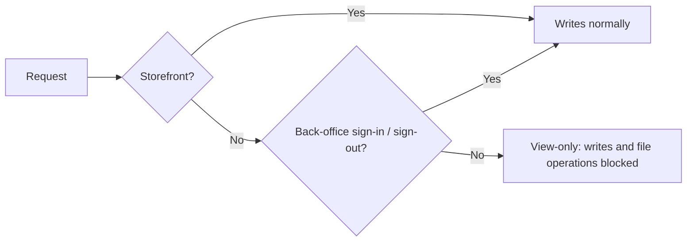

> 🌐 **Language:** [🇻🇳 Tiếng Việt](./readme_vi.md) · 🇬🇧 English (current) · [🇯🇵 日本語](./readme_ja.md)

# SandboxDemo — Demo mode for S-Cart 3.x: a working storefront, a view-only back office

## Introduction
The **SandboxDemo** plugin turns an S-Cart website into a **demo that is safe to publish**:
- **The storefront works for real.** Visitors can register, sign in, fill a cart, place orders and edit their own profile as usual.
- **Everything else is view-only.** The admin panel, the admin REST API, MCP and the vendor/partner panels show every feature, but **cannot change any data**. Every Save/Delete/Edit is blocked with a "demo mode" notice.

This guide is for **site owners** who want to publish a demo (usually with a public demo admin account) and for **developers** who need to understand or tune the blocking. After reading it you can switch demo mode on and off and know exactly what can write and what is blocked.

## 1. Plugin information
- **Name**: SandboxDemo module
- **Developer**: GP247
- **Requires Core**: GP247 v3 (Laravel + Livewire)
- **Path**: `app/GP247/Plugins/SandboxDemo`
- **Switch**: the `SANDBOX_DEMO_ENABLED` variable in `.env`

## 2. How it works (plain language)
The rule is **deny by default: only the storefront may write**. Every request falls into one of these groups:

| Group | What it covers | While demo mode is on |
|---|---|---|
| **Storefront** | Storefront pages (register, sign in, cart, checkout, customer account…), the customer REST API (`api/front`, `api/v2/front`) | Writes normally |
| **Back-office sign-in** | Admin and vendor sign-in / sign-out | Allowed, so visitors can enter the admin |
| **Everything else** | Admin panel, admin REST API (every version), MCP, vendor/partner panels, any path not in the storefront list | **View-only**: writes are blocked whether the caller uses a session, a token or no login at all |



Blocking on "everything else" works in **two layers**:
- **Layer A — database writes.** The plugin stands in front of every statement sent to the database. **Reads** always pass and **writes** are blocked. This catches every write path: Livewire, controllers, direct queries and token-based APIs.
- **Layer B — stop the request on arrival.** Every request that is **not a view** (not GET) and a few dangerous GET links are stopped **before** they are processed. Examples: installing/removing/importing extensions, backup/restore, uploads, deleting/renaming files, downloading backups. File writes and code execution therefore never start.

The plugin **does not rely on anything the browser declares about itself** (such as the Referer header) to decide whether a request belongs to the storefront. Instead it uses the route the server matched and Livewire data signed by the server. A visitor cannot "pretend" to be a storefront request.

## 3. Install and enable demo mode
1. Make sure the source sits at `app/GP247/Plugins/SandboxDemo`.
2. In the admin, open **Extensions**, find **SandboxDemo**, click **Install**.
3. After installing, click **Enable**.
4. Open the `.env` file in the site root, add (or edit) exactly this line and save:

   ```
   SANDBOX_DEMO_ENABLED=1
   ```

5. Clear the configuration cache so the change takes effect. Open a **terminal** in the site root, type the line below and press Enter:

   ```
   php artisan optimize:clear
   ```

   On success the screen shows a few `... DONE` lines. From now on, sign in to the admin and press **Save** on any screen: the system replies "Demo mode: only the storefront can change data" and the data **does not change**. Go to the storefront and try registering and ordering: everything works as usual.

**Turn demo mode off:** set `SANDBOX_DEMO_ENABLED=0` (or remove the line) and run `php artisan optimize:clear` again. `=0` disables the blocking **even if** the plugin is still enabled in the admin.

### Install from the command line (CLI, gp247 3.x)

Since gp247 3.x you can download **SandboxDemo** from the GP247 library and install it straight from the command line, without opening the admin. Open a terminal in the website's root folder and run:

```bash
# 1) Once per website: register the (free) API License that connects the site to the GP247 library
php artisan gp247:ext-register-license

# 2) Download the plugin from the library and install it
php artisan gp247:ext-install --type=plugin --key=SandboxDemo
```

- Before step 1, make sure `APP_URL` in `.env` is the website's **real domain** (not `http://localhost`) — the license is bound to that domain.
- Once installed, the plugin is **enabled** and caches are refreshed automatically; nothing else is needed in the admin.
- The command checks the requirements declared in `gp247.json` (core version, composer packages, required plugins) and stops with a clear message if something is missing.
- If the folder `app/GP247/Plugins/SandboxDemo` is already on the server (copied manually or shipped with the installer), the command **installs it in place** instead of downloading it again.
- The command refuses a plugin that is already installed. To move to a newer version, run `php artisan gp247:ext-update --type=plugin --key=SandboxDemo`.
- Append `--json` to get machine-readable output (for scripts/CI).
- The command replaces steps 1–3 above (placing the folder, **Install**, **Enable**). **After a CLI install, demo mode is still OFF**: you still need step 4 (add `SANDBOX_DEMO_ENABLED=1` to `.env`) and step 5 (`php artisan optimize:clear`) before the blocking takes effect.
- `php artisan` commands (including a scheduled command that resets the demo data) are **not** blocked, because the site owner runs them on the server.
- More: [Installing Plugins & Templates](https://github.com/gp247net/gp247-docs/blob/main/extension/install-extension.md) · [Command reference](https://github.com/gp247net/gp247-docs/blob/main/cli/cli-extensions.md).

## 4. Customisation (for developers)
Every list lives in `app/GP247/Plugins/SandboxDemo/config.php`: edit it there, with **no need** to touch core code:

| Key | Default | Use it when |
|---|---|---|
| `storefront_route_groups` | `front` | Route groups treated as storefront |
| `storefront_path_prefixes` | `api/front`, `api/v2/front` | Paths of the customer REST API |
| `storefront_route_names` | `shop.shipping.webhook` | Storefront routes outside the `front` group. **If a payment/shipping plugin has its own webhook or return page**, add its route name here so the demo can process test payments. |
| `operator_auth_routes` | admin and vendor sign-in/sign-out | Sign-in routes that stay open. Password reset and vendor self-registration are **deliberately** left out. |
| `blocked_get_routes` | destructive File Manager actions + backup download | GET links blocked even though they only "open a link" |
| `infra_write_allowlist` | `sessions`, `cache`, `cache_locks` | Infrastructure tables still writable in view-only areas, so sessions keep working |

## 5. Conditions & constraints (read before you act)
Know the rules so a block notice never surprises you.

**When is demo mode in effect?**
- **The switch alone decides**: `SANDBOX_DEMO_ENABLED=1` in `.env`. With `=0` or no such line, the plugin blocks nothing (even if enabled in the admin).
- Blocking **does not depend** on whether the caller is signed in, or how.

**What is blocked (while demo mode is on)?** Everything outside the storefront:
- **Every data write** in the admin and in vendor/partner panels.
- **The admin REST API and MCP are fully closed**, including token sign-in and reads. The demo account is public, so every token-based entrance has to be closed.
- **Installing/removing/importing/updating/enabling/disabling extensions, backup/restore, downloading backups.** A backup holds customer data and hashed passwords; downloading it is not "viewing a feature".
- **File Manager file operations**: delete, rename, move, resize, crop, new folder, upload.
- **Uploading files in the back office** (images, data-import files…) and every action on the **backup screens**, which become view-only, including the connection test for off-site storage.
- **Back-office password reset and vendor self-registration.**
- **Writes whose target table cannot be determined** (safety first: better a false block than a leak).

**What is always allowed?**
- **The whole storefront**: register, sign in, cart, checkout/order, edit profile/addresses, including through the customer REST API.
- **Every view action** in the admin: open lists, search, filter, paginate, open forms.
- **Sign-in / sign-out** of the admin and vendor panels.
- **Commands run on the server** (`php artisan`, queue workers, the scheduler).

**Out of scope:** effects **outside the database** triggered by **the storefront** are **not** blocked yet, such as order-confirmation emails or payment-gateway calls. On a public demo server, configure email and payment gateways in their test/sandbox mode.

## 6. Support
- Website: `https://GP247.net`
- Email: `support@gp247.net`

## Q&A
**Q1: I enabled the plugin in the admin, why is nothing blocked?**

→ The `.env` switch is missing. Add `SANDBOX_DEMO_ENABLED=1` to `.env`, run `php artisan optimize:clear`, then try again.

**Q2: Can visitors register and buy on the demo site?**

→ Yes. The whole storefront works for real: register, sign in, cart, order, edit profile, including through the customer REST API.

**Q3: Will visitors be signed out all the time?**

→ No. Session and cache tables are still written, and admin sign-in/sign-out is always allowed.

**Q4: Can visitors paginate and search in the admin?**

→ Yes. Viewing, searching, filtering and paginating are allowed; only actions that **change data** are blocked.

**Q5: Why are the admin REST API and MCP unavailable in demo mode?**

→ The demo account is public, so anyone could obtain a token. To leave no way around the blocking, both entrances are closed while demo mode is on, reads included. The customer REST API keeps working.

**Q6: Can someone get around it by sending requests by hand (devtools, curl)?**

→ No. The plugin blocks whatever the caller's login. It also never trusts what the browser declares: Livewire requests are recognised from data signed by the server, not from the Referer header.

**Q7: A test payment on the demo does not update the order status. What do I do?**

→ The payment plugin's webhook or return page is probably outside the storefront route group. Add that route name to `storefront_route_names` in `config.php`, then run `php artisan optimize:clear`.

**Q8: What does a visitor see when something is blocked?**

→ A short notice "Demo mode: only the storefront can change data". On Livewire admin screens it is a toast; on the API it is a JSON `{error:1, msg}` with status 403.

**Q9: How do I switch demo mode off quickly?**

→ Set `SANDBOX_DEMO_ENABLED=0` in `.env` (or remove the line) and run `php artisan optimize:clear`. This works even while the plugin is enabled.

**Q10: Does the plugin change my data or schema?**

→ No. It only **blocks** while demo mode is on; it adds no tables and changes none of your business data.

---

<sub>📅 **Last updated:** 2026-11-18 · ✍️ **Author:** GP247</sub>
