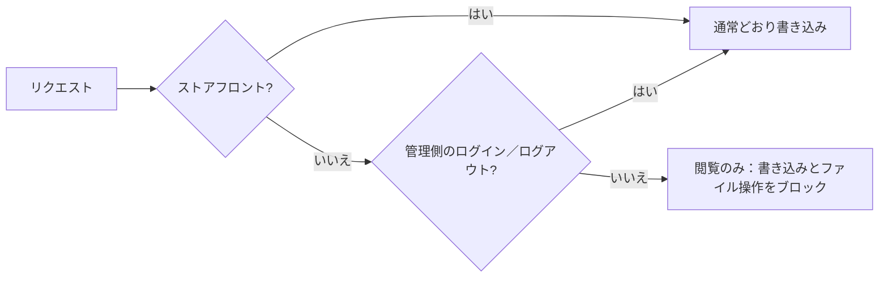

> 🌐 **言語:** [🇻🇳 Tiếng Việt](./readme_vi.md) · [🇬🇧 English](./readme.md) · 🇯🇵 日本語（現在）

# SandboxDemo — S-Cart 3.x 向けデモモード：ストアフロントは実際に動作、管理側は閲覧のみ

## はじめに
**SandboxDemo** プラグインは、S-Cart の Web サイトを**安全に公開できるデモ**に変えます。
- **ストアフロントは実際に動作します。** 訪問者は通常どおり、会員登録、ログイン、カートへの追加、注文、自分のプロフィールの編集ができます。
- **それ以外はすべて閲覧のみです。** 管理画面、管理用 REST API、MCP、ベンダー／パートナー画面ではすべての機能を見られますが、**データは一切変更できません**。保存・削除・編集の操作はすべてブロックされ、「デモモード」の通知が表示されます。

このドキュメントは、デモを公開したい**サイト運営者**（通常は公開のデモ管理者アカウント付き）と、ブロックの仕組みを理解・調整したい**開発者**向けです。読み終えると、デモモードのオン／オフができ、どこで書き込めてどこがブロックされるかを正確に把握できます。

## 1. プラグイン情報
- **名前**: SandboxDemo module
- **開発者**: GP247
- **必要な Core**: GP247 v3（Laravel + Livewire）
- **パス**: `app/GP247/Plugins/SandboxDemo`
- **スイッチ**: `.env` の `SANDBOX_DEMO_ENABLED` 変数

## 2. 仕組み（わかりやすく）
ルールは**「既定でブロック、書き込めるのはストアフロントだけ」**です。すべてのリクエストは次のいずれかのグループに分類されます。

| グループ | 対象 | デモモード中 |
|---|---|---|
| **ストアフロント** | ストアフロントのページ（会員登録、ログイン、カート、決済、顧客アカウントなど）、顧客向け REST API（`api/front`、`api/v2/front`） | 通常どおり書き込み可能 |
| **管理側のログイン** | 管理者とベンダーのログイン／ログアウト | 許可（訪問者が管理画面に入れるように） |
| **それ以外すべて** | 管理画面、管理用 REST API（すべてのバージョン）、MCP、ベンダー／パートナー画面、ストアフロント一覧にないすべてのパス | **閲覧のみ**：セッション、トークン、未ログインのどれでも書き込みはブロック |



「それ以外すべて」のブロックは**2 層**で行います。
- **レイヤー A — データベースへの書き込み。** プラグインはデータベースに送られるすべての文の手前に立ちます。**読み取り**は常に通し、**書き込み**はブロックします。Livewire、コントローラー、直接のクエリ、トークンを使う API など、すべての書き込み経路を捕捉します。
- **レイヤー B — 受け付けた時点で止める。** **閲覧ではない**リクエスト（GET 以外）と一部の危険な GET リンクは、処理される**前に**止まります。例：拡張機能のインストール／削除／インポート、バックアップ／復元、アップロード、ファイルの削除／名前変更、バックアップのダウンロード。そのため、ファイルの書き込みやコードの実行は始まりません。

プラグインは、リクエストがストアフロントかどうかを判断するのに**ブラウザーが自己申告する情報**（Referer ヘッダーなど）を**使いません**。サーバーが照合したルートと、サーバーが署名した Livewire のデータを使います。訪問者がストアフロントのリクエストに「なりすます」ことはできません。

## 3. インストールとデモモードの有効化
1. ソースが `app/GP247/Plugins/SandboxDemo` にあることを確認します。
2. 管理画面で **Extensions（拡張機能）** を開き、**SandboxDemo** を探して **Install（インストール）** をクリックします。
3. インストール後、**Enable（有効化）** をクリックします。
4. サイトのルートにある `.env` ファイルを開き、次の行をそのまま追加（または修正）して保存します。

   ```
   SANDBOX_DEMO_ENABLED=1
   ```

5. 変更を反映するため、設定キャッシュをクリアします。サイトのルートで**ターミナル**を開き、次の行を入力して Enter を押します。

   ```
   php artisan optimize:clear
   ```

   成功すると、画面に `... DONE` の行がいくつか表示されます。これ以降、管理画面にログインして任意の画面で**保存**を押すと、「デモモード: データを変更できるのはストアフロントだけです」と表示され、データは**変わりません**。ストアフロントで会員登録と注文を試すと、すべて通常どおり動作します。

**デモモードをオフにする:** `SANDBOX_DEMO_ENABLED=0` に戻す（またはその行を削除する）と、`php artisan optimize:clear` をもう一度実行します。`=0` にすると、管理画面でプラグインが有効のままでも**ブロックは解除**されます。

### コマンドラインでインストール（CLI、gp247 3.x）

gp247 3.x 以降では、管理画面を開かずに、GP247 ライブラリから **SandboxDemo** をダウンロードしてコマンドラインですぐにインストールできます。Web サイトのルートフォルダーでターミナルを開き、次を実行します。

```bash
# 1) 各 Web サイトで1回だけ：GP247 ライブラリに接続するための API License（無料）を登録
php artisan gp247:ext-register-license

# 2) ライブラリからプラグインをダウンロードしてインストール
php artisan gp247:ext-install --type=plugin --key=SandboxDemo
```

- 手順1の前に、`.env` の `APP_URL` が Web サイトの**実際のドメイン**であることを確認してください（`http://localhost` のままにしないでください）。ライセンスはこのドメインに紐付けられます。
- インストールが完了すると、プラグインは**有効化済み**になり、キャッシュも自動で更新されます。管理画面で追加の操作は必要ありません。
- コマンドは `gp247.json` で宣言された条件（core のバージョン、composer パッケージ、依存プラグイン）を自動で確認します。不足があれば、何が足りないかを明示して停止します。
- `app/GP247/Plugins/SandboxDemo` フォルダーが既にサーバー上にある場合（手動でコピーした、またはインストーラーに同梱されていた場合）、コマンドは再ダウンロードせずに**その場でインストール**します。
- プラグインが既にインストールされている場合、コマンドは拒否します。新しいバージョンにするには `php artisan gp247:ext-update --type=plugin --key=SandboxDemo` を実行します。
- コマンドの末尾に `--json` を付けると、機械で読める形式の結果を受け取れます（スクリプト / CI 用）。
- このコマンドは上記の手順1〜3（フォルダーの配置、「**Install**」、「**Enable**」）の代わりになります。**CLI でインストールした直後は、デモモードはまだオフです**：ブロックを有効にするには、手順4（`.env` に `SANDBOX_DEMO_ENABLED=1` を追加）と手順5（`php artisan optimize:clear`）を行う必要があります。
- `php artisan` コマンド（デモデータをリセットする定期実行コマンドを含む）は、サイト運営者がサーバー上で実行するものなので、ブロック**されません**。
- 詳細：[プラグインとテンプレートのインストールガイド](https://github.com/gp247-official/gp247-docs/blob/main/extension/install-extension.md) · [コマンドリファレンス](https://github.com/gp247-official/gp247-docs/blob/main/cli/cli-extensions_ja.md)。

## 4. カスタマイズ（開発者向け）
すべての一覧は `app/GP247/Plugins/SandboxDemo/config.php` にあります。ここを編集すればよく、コアのコードに触れる**必要はありません**。

| キー | 既定値 | 使う場面 |
|---|---|---|
| `storefront_route_groups` | `front` | ストアフロントとみなすルートグループ |
| `storefront_path_prefixes` | `api/front`、`api/v2/front` | 顧客向け REST API のパス |
| `storefront_route_names` | `shop.shipping.webhook` | `front` グループ外にあるストアフロントのルート。**決済／配送プラグインに独自の Webhook や戻りページがある場合**、デモでテスト決済を処理できるよう、そのルート名をここに追加します。 |
| `operator_auth_routes` | 管理者とベンダーのログイン／ログアウト | 開いたままにするログインのルート。パスワードの再設定とベンダーの自己登録は**意図的に**含めていません。 |
| `blocked_get_routes` | File Manager の破壊的な操作 + バックアップのダウンロード | 「リンクを開く」だけでもブロックする GET リンク |
| `infra_write_allowlist` | `sessions`、`cache`、`cache_locks` | 閲覧のみの領域でも書き込めるインフラ用テーブル（セッションを維持するため） |

## 5. 条件と制約（操作の前に理解しておくこと）
ブロック通知に驚かないよう、ルールを把握しておきましょう。

**デモモードはいつ有効になりますか？**
- **スイッチだけで決まります**：`.env` の `SANDBOX_DEMO_ENABLED=1`。`=0` またはこの行がない場合、プラグインは何もブロックしません（管理画面で有効にしていても）。
- ブロックは、呼び出し元がログインしているかどうか、どの方法でログインしているかに**依存しません**。

**何がブロックされますか（デモモード中）？** ストアフロント以外のすべてで:
- 管理画面とベンダー／パートナー画面での**すべてのデータ書き込み**。
- **管理用 REST API と MCP は完全に閉じます**。トークンでのログインと読み取りも含みます。デモアカウントは公開されているため、トークンによる入口はすべて閉じる必要があります。
- **拡張機能のインストール／削除／インポート／更新／有効化／無効化、バックアップ／復元、バックアップのダウンロード。** バックアップには顧客データとハッシュ化されたパスワードが含まれるため、そのダウンロードは「機能を見る」ことではありません。
- **File Manager のファイル操作**：削除、名前変更、移動、リサイズ、切り抜き、フォルダー作成、アップロード。
- **管理側でのファイルのアップロード**（画像、データ取り込み用ファイルなど）と、**バックアップ画面**でのすべての操作。バックアップ画面は外部ストレージへの接続テストも含めて閲覧のみになります。
- **管理側のパスワード再設定とベンダーの自己登録。**
- **対象テーブルを判定できない書き込み**（安全第一：漏れるよりは誤ってブロックするほうがよい）。

**常に許可されるものは？**
- **ストアフロント全体**：会員登録、ログイン、カート、決済／注文、プロフィール／住所の編集。顧客向け REST API 経由も含みます。
- 管理画面での**すべての閲覧操作**：一覧を開く、検索、絞り込み、ページ送り、フォームを開く。
- 管理画面とベンダー画面の**ログイン／ログアウト**。
- **サーバー上で実行するコマンド**（`php artisan`、キューワーカー、スケジューラー）。

**対象外：** **ストアフロント**が引き起こす**データベース外**への影響（注文確認メール、決済ゲートウェイの呼び出しなど）は、まだブロック**されません**。公開デモサーバーでは、メールと決済ゲートウェイをテスト／サンドボックスモードに設定してください。

## 6. サポート
- Web サイト: `https://GP247.net`
- メール: `support@gp247.net`

## Q&A
**Q1: 管理画面でプラグインを有効にしたのに、何もブロックされないのはなぜですか？**

→ `.env` のスイッチがありません。`.env` に `SANDBOX_DEMO_ENABLED=1` を追加し、`php artisan optimize:clear` を実行してから、もう一度お試しください。

**Q2: デモサイトで訪問者は会員登録や購入ができますか？**

→ はい。ストアフロント全体が実際に動作します。会員登録、ログイン、カート、注文、プロフィール編集が、顧客向け REST API 経由でも可能です。

**Q3: 訪問者は何度もログアウトされませんか？**

→ されません。セッションとキャッシュのテーブルには引き続き書き込まれ、管理画面のログイン／ログアウトは常に許可されます。

**Q4: 訪問者は管理画面でページ送りや検索ができますか？**

→ はい。閲覧、検索、絞り込み、ページ送りは許可されます。ブロックされるのは**データを変更する**操作だけです。

**Q5: デモモードで管理用 REST API と MCP が使えないのはなぜですか？**

→ デモアカウントは公開されているため、誰でもトークンを取得できてしまいます。ブロックを回避する道を残さないよう、デモモード中はこの 2 つの入口を読み取りも含めて閉じます。顧客向け REST API は引き続き動作します。

**Q6: 手作業でリクエストを送る（devtools、curl）ことで回避できますか？**

→ できません。プラグインは、呼び出し元のログイン方法に関係なくブロックします。また、ブラウザーの自己申告は信用しません。Livewire のリクエストは Referer ヘッダーではなく、サーバーが署名したデータから判定します。

**Q7: デモでのテスト決済で注文ステータスが更新されません。どうすればよいですか？**

→ 決済プラグインの Webhook や戻りページが、ストアフロントのルートグループ外にある可能性があります。そのルート名を `config.php` の `storefront_route_names` に追加し、`php artisan optimize:clear` を実行してください。

**Q8: ブロックされたとき、訪問者には何が表示されますか？**

→ 「デモモード: データを変更できるのはストアフロントだけです」という短い通知です。Livewire の管理画面ではトースト通知、API ではステータス 403 の JSON `{error:1, msg}` になります。

**Q9: デモモードをすぐにオフにするには？**

→ `.env` の `SANDBOX_DEMO_ENABLED=0` に変更（またはその行を削除）し、`php artisan optimize:clear` を実行します。プラグインが有効のままでもオフにできます。

**Q10: プラグインは私のデータや構造を変更しますか？**

→ しません。デモモード中に**ブロック**するだけで、テーブルの追加や業務データの変更は行いません。

---

<sub>📅 **最終更新:** 2026-11-18 · ✍️ **作成者 (Author):** GP247</sub>
