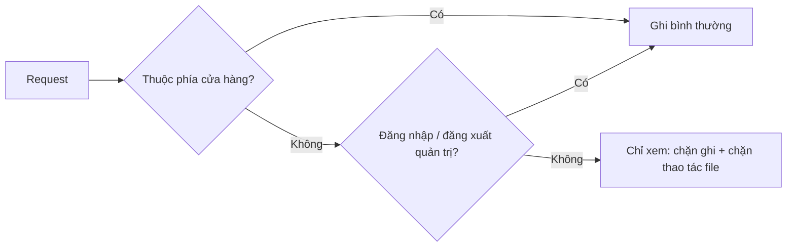

> 🌐 **Ngôn ngữ:** 🇻🇳 Tiếng Việt (hiện tại) · [🇬🇧 English](./readme.md) · [🇯🇵 日本語](./readme_ja.md)

# SandboxDemo — Chế độ demo cho GP247 v3: cửa hàng dùng thật, quản trị chỉ xem

## Giới thiệu
Plugin **SandboxDemo** biến website GP247 thành một **bản demo an toàn để công khai**:
- **Phía cửa hàng dùng thật.** Khách đăng ký thành viên, đăng nhập, thêm giỏ hàng, đặt hàng, sửa hồ sơ của mình bình thường.
- **Mọi chỗ khác chỉ xem.** Trang quản trị, REST API quản trị, MCP và trang của vendor/đối tác cho xem mọi tính năng, nhưng **không thể thay đổi dữ liệu**. Mọi thao tác Lưu/Xoá/Sửa bị chặn và hiện thông báo "chế độ demo".

Tài liệu này dành cho **chủ site** muốn công khai một bản demo (thường kèm tài khoản admin demo công khai), và cho **lập trình viên** cần hiểu hoặc tuỳ chỉnh cơ chế chặn. Đọc xong bạn sẽ bật/tắt được chế độ demo và biết chính xác chỗ nào được ghi, chỗ nào bị chặn.

## 1. Thông tin plugin
- **Tên**: SandboxDemo module
- **Nhà phát triển**: GP247
- **Yêu cầu Core**: GP247 v3 (Laravel + Livewire)
- **Đường dẫn**: `app/GP247/Plugins/SandboxDemo`
- **Công tắc**: biến `SANDBOX_DEMO_ENABLED` trong file `.env`

## 2. Cơ chế hoạt động (dễ hiểu)
Nguyên tắc là **chặn mặc định, chỉ phía cửa hàng được ghi**. Mỗi request được xếp vào một trong các nhóm sau:

| Nhóm | Gồm những gì | Khi demo bật |
|---|---|---|
| **Cửa hàng** | Trang storefront (đăng ký, đăng nhập, giỏ hàng, thanh toán, tài khoản khách…), REST API của khách (`api/front`, `api/v2/front`) | Ghi bình thường |
| **Đăng nhập quản trị** | Đăng nhập / đăng xuất của admin và vendor | Cho phép, để người xem vào được trang quản trị |
| **Mọi chỗ khác** | Trang quản trị, REST API quản trị (mọi phiên bản), MCP, trang vendor/đối tác, mọi đường dẫn không có trong danh sách cửa hàng | **Chỉ xem** — chặn ghi, bất kể đăng nhập bằng phiên, bằng token hay chưa đăng nhập |



Việc chặn ở "mọi chỗ khác" có **hai lớp**:
- **Lớp A — chặn ghi cơ sở dữ liệu.** Plugin đứng ngay trước cửa của mọi câu lệnh gửi tới cơ sở dữ liệu. Câu **đọc** luôn cho qua, câu **ghi** bị chặn. Lớp này bắt được mọi đường ghi: Livewire, controller, truy vấn trực tiếp, API dùng token.
- **Lớp B — chặn ngay khi nhận request.** Mọi request **không phải xem** (không phải GET), cùng một số link GET nguy hiểm, bị dừng **trước khi** được xử lý. Ví dụ: cài/gỡ/nhập tiện ích, sao lưu/phục hồi, tải ảnh lên, xoá/đổi tên file, tải bản sao lưu. Nhờ đó các thao tác ghi file hay chạy mã không bao giờ bắt đầu.

Plugin **không dựa vào thông tin trình duyệt tự gửi** (như header Referer) để quyết định một request có thuộc cửa hàng hay không. Thay vào đó nó dùng đường dẫn mà máy chủ đã nhận diện, và dữ liệu Livewire có chữ ký của máy chủ. Người xem không thể "giả làm" request của cửa hàng.

## 3. Cài đặt và bật chế độ demo
1. Đảm bảo mã nguồn nằm đúng đường dẫn `app/GP247/Plugins/SandboxDemo`.
2. Vào trang quản trị **Extensions (Tiện ích mở rộng)**, tìm plugin **SandboxDemo**, nhấn **Install (Cài đặt)**.
3. Sau khi cài, nhấn **Enable (Kích hoạt)**.
4. Mở file `.env` ở thư mục gốc của site, thêm (hoặc sửa) đúng dòng sau rồi lưu lại:

   ```
   SANDBOX_DEMO_ENABLED=1
   ```

5. Xoá bộ nhớ đệm cấu hình để thay đổi có hiệu lực. Mở **Terminal** tại thư mục gốc site, gõ dòng sau rồi nhấn Enter:

   ```
   php artisan optimize:clear
   ```

   Nếu thành công, màn hình hiện vài dòng `... DONE`. Từ lúc này, đăng nhập admin và thử bấm **Lưu** ở bất kỳ màn nào: hệ thống báo "Chế độ demo: chỉ phía cửa hàng được thay đổi dữ liệu" và dữ liệu **không đổi**. Ra ngoài cửa hàng, thử đăng ký và đặt hàng: mọi thứ chạy bình thường.

**Tắt chế độ demo:** đổi lại thành `SANDBOX_DEMO_ENABLED=0` (hoặc xoá dòng đó) rồi chạy lại `php artisan optimize:clear`. Đặt `=0` sẽ tắt chặn **ngay cả khi** plugin vẫn đang Enable trong admin.

### Cài bằng dòng lệnh (CLI, gp247 3.x)

Từ gp247 3.x, bạn có thể tải **SandboxDemo** từ thư viện GP247 và cài ngay bằng dòng lệnh mà không cần mở admin. Mở Terminal tại thư mục gốc website rồi chạy:

```bash
# 1) Chỉ làm 1 lần cho mỗi website: đăng ký API License (miễn phí) để kết nối thư viện GP247
php artisan gp247:ext-register-license

# 2) Tải plugin từ thư viện và cài
php artisan gp247:ext-install --type=plugin --key=SandboxDemo
```

- Trước bước 1, kiểm tra `APP_URL` trong `.env` là **domain thật** của website (không để `http://localhost`), vì license được gắn với domain này.
- Cài xong, plugin được **bật sẵn** và cache tự làm mới, bạn không cần thao tác gì thêm trong admin.
- Lệnh tự kiểm tra điều kiện khai báo trong `gp247.json` (phiên bản core, gói composer, plugin phụ thuộc). Nếu thiếu, lệnh dừng lại và báo rõ thiếu gì.
- Nếu thư mục `app/GP247/Plugins/SandboxDemo` đã có sẵn trên máy (chép thủ công hoặc có sẵn theo bộ cài), lệnh sẽ **cài tại chỗ**, không tải lại.
- Nếu plugin đã được cài, lệnh sẽ từ chối. Để lên bản mới, chạy `php artisan gp247:ext-update --type=plugin --key=SandboxDemo`.
- Thêm `--json` vào cuối lệnh để nhận kết quả dạng máy đọc được (dùng cho script/CI).
- Lệnh thay cho các bước 1–3 ở trên (đặt thư mục, **Install**, **Enable**). **Cài xong bằng CLI, chế độ demo vẫn đang TẮT**: bạn vẫn phải làm bước 4 (thêm `SANDBOX_DEMO_ENABLED=1` vào `.env`) và bước 5 (`php artisan optimize:clear`) thì việc chặn mới có hiệu lực.
- Các lệnh `php artisan` (kể cả lệnh làm mới dữ liệu demo chạy theo lịch) **không** bị chặn, vì chúng do chủ site chạy trên máy chủ.
- Chi tiết: [Hướng dẫn cài đặt Plugin & Template](https://github.com/gp247net/gp247-docs/blob/main/extension/install-extension_vi.md) · [Tra cứu lệnh](https://github.com/gp247net/gp247-docs/blob/main/cli/cli-extensions_vi.md).

## 4. Tuỳ chỉnh (dành cho lập trình viên)
Mọi danh sách đều khai trong file `app/GP247/Plugins/SandboxDemo/config.php`, sửa ở đây, **không cần** đụng vào mã lõi:

| Khoá | Mặc định | Dùng khi nào |
|---|---|---|
| `storefront_route_groups` | `front` | Nhóm route được coi là cửa hàng |
| `storefront_path_prefixes` | `api/front`, `api/v2/front` | Đường dẫn REST API của khách |
| `storefront_route_names` | `shop.shipping.webhook` | Route của cửa hàng nằm ngoài nhóm `front`. **Plugin thanh toán/vận chuyển có webhook hay trang trả về riêng** thì thêm tên route vào đây, nếu muốn demo xử lý được thanh toán thử. |
| `operator_auth_routes` | đăng nhập/đăng xuất admin và vendor | Route đăng nhập được phép. Quên/đặt lại mật khẩu và tự đăng ký vendor **cố ý không** có trong danh sách. |
| `blocked_get_routes` | các thao tác phá huỷ của File Manager + tải bản sao lưu | Link GET bị chặn dù chỉ là "mở link" |
| `infra_write_allowlist` | `sessions`, `cache`, `cache_locks` | Bảng hạ tầng vẫn được ghi ở khu chỉ-xem, để giữ phiên đăng nhập |

## 5. Điều kiện & ràng buộc (hiểu trước khi thao tác)
Nắm rõ luật chơi để không bất ngờ khi thấy thông báo chặn.

**Khi nào chế độ demo có hiệu lực?**
- **Chỉ cần bật công tắc** `SANDBOX_DEMO_ENABLED=1` trong `.env`. Nếu `=0` hoặc không có dòng này, plugin không chặn gì (dù đã Enable trong admin).
- Việc chặn **không phụ thuộc** người gọi đã đăng nhập hay chưa, đăng nhập kiểu gì.

**Thao tác nào bị chặn (khi demo bật)?** Áp cho mọi chỗ ngoài phía cửa hàng:
- **Mọi thao tác ghi dữ liệu** ở trang quản trị, trang vendor/đối tác.
- **REST API quản trị và MCP đóng hoàn toàn**, kể cả đăng nhập lấy token và thao tác đọc. Lý do: tài khoản demo là công khai, nên mọi cửa vào bằng token đều phải đóng.
- **Cài/gỡ/nhập/cập nhật/bật/tắt tiện ích, sao lưu/phục hồi, tải bản sao lưu về**: bản sao lưu chứa dữ liệu khách và mật khẩu đã mã hoá, không phải "xem tính năng".
- **Thao tác file của File Manager**: xoá, đổi tên, di chuyển, resize, cắt ảnh, tạo thư mục, tải ảnh lên.
- **Tải file lên ở khu quản trị** (ảnh, file nhập dữ liệu…), và mọi thao tác trên **màn sao lưu**: màn này chỉ còn xem, kể cả nút thử kết nối tới nơi lưu trữ ngoài.
- **Quên/đặt lại mật khẩu quản trị, tự đăng ký vendor.**
- **Câu ghi không xác định được bảng** (nguyên tắc an toàn: thà chặn nhầm còn hơn cho lọt).

**Thao tác nào luôn được phép?**
- **Toàn bộ phía cửa hàng**: tạo tài khoản, đăng nhập, giỏ hàng, thanh toán/đặt hàng, sửa hồ sơ/địa chỉ, cả qua REST API của khách.
- **Mọi thao tác xem** trong trang quản trị: mở danh sách, tìm kiếm, lọc, phân trang, mở form xem.
- **Đăng nhập / đăng xuất** trang quản trị và trang vendor.
- **Lệnh chạy trên máy chủ** (`php artisan`, hàng đợi, lịch chạy).

**Ngoài phạm vi:** các tác động **ra ngoài cơ sở dữ liệu** do **phía cửa hàng** gây ra hiện **chưa** bị chặn, ví dụ email xác nhận đơn hàng hay gọi cổng thanh toán. Với server demo công khai, nên cấu hình email/cổng thanh toán ở chế độ thử (test/sandbox của nhà cung cấp).

## 6. Hỗ trợ
- Website: `https://GP247.net`
- Email: `support@gp247.net`

## Hỏi & Đáp (Q&A)
**Câu 1: Tôi đã Enable plugin trong admin mà sao chưa thấy chặn gì?**

→ Vì còn thiếu công tắc `.env`. Thêm `SANDBOX_DEMO_ENABLED=1` vào file `.env`, chạy `php artisan optimize:clear`, rồi thử lại.

**Câu 2: Khách có đăng ký, mua hàng được trên site demo không?**

→ Có. Toàn bộ phía cửa hàng chạy thật: đăng ký, đăng nhập, giỏ hàng, đặt hàng, sửa hồ sơ, cả qua REST API của khách.

**Câu 3: Bật demo lên thì người xem có bị đăng xuất liên tục không?**

→ Không. Bảng phiên đăng nhập/bộ đệm vẫn được ghi, và đăng nhập/đăng xuất quản trị luôn được phép.

**Câu 4: Người xem phân trang, tìm kiếm trong trang quản trị được không?**

→ Được. Xem, tìm kiếm, lọc, phân trang đều được phép; chỉ các thao tác **thay đổi dữ liệu** mới bị chặn.

**Câu 5: Vì sao REST API quản trị và MCP không dùng được khi bật demo?**

→ Tài khoản demo là công khai, nên ai cũng có thể lấy token. Để không còn đường lách nào, hai cửa này đóng hẳn khi bật demo, kể cả đọc. REST API của khách vẫn chạy bình thường.

**Câu 6: Có ai lách được bằng cách tự gửi request (devtools, curl) không?**

→ Không. Plugin chặn bất kể người gọi đăng nhập kiểu gì. Nó cũng không tin thông tin trình duyệt tự khai: request Livewire được nhận diện qua dữ liệu có chữ ký của máy chủ, không qua header Referer.

**Câu 7: Thanh toán thử trên demo không cập nhật trạng thái đơn, sửa sao?**

→ Có thể webhook/trang trả về của plugin thanh toán nằm ngoài nhóm route cửa hàng. Thêm tên route đó vào `storefront_route_names` trong `config.php`, rồi chạy `php artisan optimize:clear`.

**Câu 8: Khi bị chặn, người xem thấy gì?**

→ Một thông báo gọn "Chế độ demo: chỉ phía cửa hàng được thay đổi dữ liệu". Trên màn admin Livewire, đó là thông báo nổi. Với API, đó là JSON `{error:1, msg}` mã 403.

**Câu 9: Làm sao tắt nhanh chế độ demo?**

→ Đổi `SANDBOX_DEMO_ENABLED=0` trong `.env` (hoặc xoá dòng đó), chạy `php artisan optimize:clear`. Tắt được ngay cả khi plugin vẫn Enable.

**Câu 10: Plugin có sửa dữ liệu hay cấu trúc gì của tôi không?**

→ Không. Plugin chỉ **chặn** khi demo bật; nó không thêm bảng, không đổi dữ liệu nghiệp vụ của bạn.

---

<sub>📅 **Cập nhật lần cuối:** 2026-11-18 · ✍️ **Tác giả (Author):** GP247</sub>
